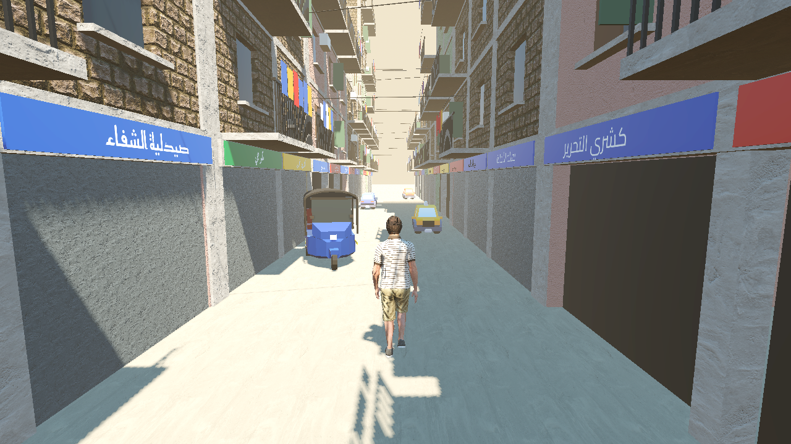
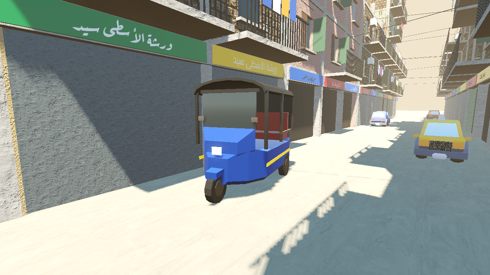
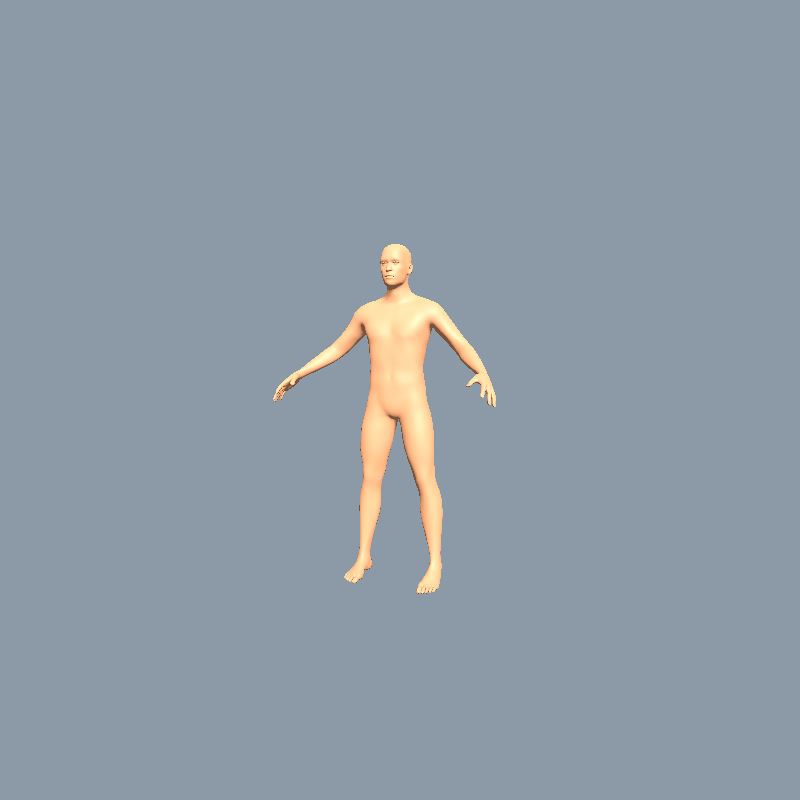

# «الحارة» — الخطة الكاملة v0.2

> لعبة عالم مفتوح بمهام زي GTA، جوّه حيّ شعبي مصري، **الكاميرا من ورا وفوق الشخصية زي GTA بالظبط**، و**الهدف الأول إنها تشتغل على الأجهزة الضعيفة جداً** (4 جيجا رام وكارت شاشة مدمج) وحجمها صغير.
>
> **التغيير الأساسي عن v0.1:** اللي هيبني اللعبة هو Claude بالكامل: الكود، والمباني، والعربيات، والشخصيات، والأرض، والأنظمة، والمهام. دور صاحب المشروع إنه يجرّب ويقول رأيه ويوفّر الحاجات اللي محتاجة إنسان بس (القسم 2). عشان كده درست كل حاجة تاني **وجرّبتها عملياً** قبل ما أكتب حرف (القسم 1).

---

## 0. الخلاصة

| الموضوع | القرار |
|---|---|
| مين بيبني | **Claude**: كل الكود، وكل الموديلات بتتولّد **بسكريبتات** (Blender في وضع headless + Godot)، ومعاها أصول مجانية رخصتها **CC0 / MIT** اتأكدت منها ونزلتها فعلاً. |
| المحرك | **Godot 4.7** (مفتوح المصدر، رخصة MIT، ببلاش ومن غير نسبة) بالـ **Compatibility renderer (OpenGL 3.3)** عشان الأجهزة الضعيفة، + **مكتبة C++ خاصة بينا** للأنظمة التقيلة (ليه مش محرك من الصفر: القسم 4). |
| الكاميرا | **Third-person chase camera زي GTA**: ورا الشخصية وفوقها، بتلف بالماوس، وبتقرّب أوتوماتيك في الحواري الضيقة عشان ماتخترقش الحيطان (القسم 5). |
| الشكل المستهدف | **"واقعي خفيف"**: في مستوى GTA San Andreas المحسّن لحد GTA IV المبسّط. **مش GTA V**، وده مقصود عشان الأجهزة الضعيفة. |
| الحد الأدنى | 4GB رام، 2 كور، Intel HD 4400 / UHD 620 / GT 710، هارد HDD، 720p @ 30fps. |
| الحجم | أول نسخة للبيع ≤ **2–3GB**، والكاملة ≤ **5GB**. |
| الطريق | 8 محطات (Milestones)، كل محطة بتنتهي بنسخة Windows تنزّلها وتجرّبها (القسم 12). |

---

## 1. اللي جرّبته عملياً قبل الخطة (Proof)

اشتغلت جوّه الكونتينر بتاعي (Linux من غير كارت شاشة) واتأكدت من كل نقطة:

| الاختبار | النتيجة |
|---|---|
| تشغيل **Godot 4.7.2** والرسم بالـ Compatibility renderer وأخد screenshots | ✅ شغال بـ OpenGL software (llvmpipe). **أقدر أشوف اللعبة بنفسي** في كل خطوة. |
| تشغيل **Blender 4.2** من غير شاشة وتوليد موديلات بالكود وتصديرها glTF | ✅ |
| **مولّد مباني مصرية** (أعمدة خرسانة، طوب أحمر أو محارة ملونة، بلكونات بحديد، غسيل، تكييفات، دشات، خزانات، غيّة حمام، حديد طالع من السطح، محلات بصاج) | ✅ 6 مباني مختلفة، كل واحد 2–5 آلاف مثلث |
| **توك توك متعمل بالكود بالكامل** | ✅ نسخة أولى 696 مثلث (محتاجة تحسين، شوف تحت) |
| **يافطات عربي** (كشري، حلاق، صيدلية…) بخطوط Cairo / Reem Kufi / Aref Ruqaa | ✅ التشكيل والاتجاه من اليمين للشمال سليمين |
| شخصية واقعية (Microsoft Rocketbox، رخصة MIT) بأنيميشن مشي mocap | ✅ |
| **توليد إنسان من الصفر بالكود** (MPFB2 / MakeHuman، أصول CC0): جسم بملامح وأبعاد بختارها + هيكل عظمي جاهز للعبة (53 عضمة) | ✅ (الصورة تحت). الجلد واللبس والشعر في حزمة الأصول CC0 (280MB)، ولسه بتنزل وماجربتهاش |
| **لبس مصري** (جلابية، طرحة…) متولد بالكود | ⏳ **لسه ماتجرّبش**: ده أول حاجة في محطة 3، وأصعب نقطة في الأصول |
| عربيات مجانية (Kenney Car Kit، رخصة CC0) | ✅ اتنزلت، بس شكلها كرتوني ومش مناسب للستايل (هعمل العربيات بنفسي) |
| تنزيل أصول مجانية أوتوماتيك: ambientCG (تكسترات)، itch.io (Kenney / Quaternius)، GitHub (Rocketbox)، MakeHuman (أصول الشخصيات) | ✅ كلها اتنزلت، ورخصها اتقرت من جوّه الملفات نفسها |

**صور الـ Proof** (رسم software من غير كارت شاشة، أول محاولة، من غير أي تلميع):

| الحارة بكاميرا GTA | التوك توك |
|---|---|
|  |  |

| إنسان متولد بـ MPFB (من غير جلد ولبس لسه) |
|---|
|  |

**تقييمي الصريح للصور دي:**
- **الفكرة اتثبتت**: حارة متولدة بالكود، فيها روح المكان (طوب أحمر وأعمدة وغسيل وأسلاك ويافطات عربي)، بكاميرا GTA، على الرندر الخفيف.
- **دي لسه مش جودة تجارية**: لسه ناقص زبالة وتراب وبقع رطوبة على الحيطان، وأرضية فيها رصيف وبلاعات، وإضاءة متخزنة في الموديلات (baked)، وناس كتير. والتوك توك محتاج حواف ناعمة وتفاصيل. **ده شغل محطة 1 و2.**
- **درس مهم من الأداء**: المشهد ده عامل حوالي 500 draw call، لأن كل مبنى فيه 17–20 خامة. في الإنتاج **كل مبنى هيبقى خامة واحدة بتكستر atlas مشترك + vertex colors**، وده بينزّلها لأقل من 100.

سكريبتات الـ proof محفوظة في `docs/hara/proof/`.

---

## 2. تقسيم الشغل: إيه اللي عليا، وإيه اللي محتاج إنسان

### 2.1 اللي أنا (Claude) هعمله
- **كل الكود**: المحرك والأنظمة والجيمبلاي والمهام والواجهة والحفظ والإعدادات والـ build والتحديث الأوتوماتيك.
- **كل المباني والأرض والحواري**: مولّدات بالكود (Procedural)، وبعدين تعديل يدوي بالكود على الأماكن المهمة.
- **كل العربيات**: موديلات بسكريبتات Blender (التوك توك، الـ 128، الميكروباص، الموتوسيكل، الكارو…).
- **الشخصيات**: تجميع من أصول CC0/MIT + **لبس مصري بعمله بنفسي** (جلابية، عباية، طرحة…) + تنويع الوشوش والأجسام.
- **الأنيميشن**: من مكتبات مجانية (Rocketbox 471 حركة MIT، Quaternius CC0، CMU mocap) + نقلها على الهيكل العظمي بتاعنا (retargeting) بالكود + حركات بسيطة بعملها بإيدي (keyframes بالكود).
- **التكسترات**: من ambientCG و Poly Haven (CC0) + توليد بالكود (رطوبة، شروخ، بوسترات، يافطات).
- **المؤثرات الصوتية والمزيكا الخلفية**: توليد بالكود (زي ما اتعمل في جزيرة)، + أصوات CC0.
- **القصة والحوار المكتوب** بالعامية المصرية.
- **الاختبار**: صور من أماكن ثابتة في كل build، بوت بيلعب أوتوماتيك، قياس أداء، اختبارات للأنظمة.

### 2.2 اللي محتاج إنسان (إنت) — قليل لكنه مهم
| المهمة | ليه أنا مقدرش | قد إيه مهمة |
|---|---|---|
| **تجرّب كل نسخة على جهاز ضعيف حقيقي** وتبعتلي ملف الأداء اللي اللعبة بتطلعه أوتوماتيك | معنديش كارت شاشة ولا جهاز ويندوز ضعيف، والكونتينر بيقيس أداء software مش حقيقي | **حرجة**: ده هدف اللعبة الأساسي |
| **تلعب وتقولي الإحساس**: السواقة تقيلة؟ الكاميرا بتلف بسرعة؟ القتال ممتع؟ | أنا بشوف صور وأرقام، لكن "الإحساس في الإيد" محتاج حد يلعب | **حرجة** |
| **صور وفيديوهات وتسجيلات صوت من حارة حقيقية** (موبايل عادي كفاية): واجهات بيوت، أبواب، محلات، يافطات، أرضيات، توك توك من كل الجهات، صوت الشارع | مقدرش أنزل الشارع. الصور دي بتخلي الجودة تقفز. ممكن نبدأ من غيرها | **مهمة جداً** (اختيارية في البداية) |
| **التمثيل الصوتي** (ناس بتسجل الحوار بالعامية) | الأصوات المولدة بالذكاء الاصطناعي بالعامية المصرية لسه مش بمستوى تجاري، وكمان فيها مشاكل حقوق | مهمة قبل البيع، مش دلوقتي. لحد ما نوصل لها: ترجمة مكتوبة + أصوات قصيرة |
| **أغاني/مزيكا للراديو** (مهرجانات وشعبي) | محتاجة فنانين بعقود | اختيارية، وبعدين |
| **حساب Steam** (رسوم 100$ للعبة)، واسم اللعبة، والقرارات التجارية | محتاجة شخص وفلوس | قبل البيع |
| **تعمل repo جديد على GitHub** للعبة (أو تديني إذن أعمله) | ده إجراء على حسابك | **أول خطوة** |

### 2.3 اختياري ممكن يرفع الجودة
- **Mixamo** (حركات Adobe المجانية، ومسموح تستخدمها في لعبة تجارية): محتاجة تسجيل دخول بحساب Adobe. لو نزّلت منها حركات بعينها أقدر أستخدمها، بس مش ضرورية.
- لو حبيت بعدين: فنان 3D بالقطعة للبطل بس (الوش بالذات) أو للافتة اللعبة (key art).

---

## 3. مصادر الأصول — اتأكدت منها كلها

### 3.1 المصادر المجانية اللي اتنزلت فعلاً ورخصتها اتراجعت

| المصدر | فيه إيه | الرخصة | الحالة |
|---|---|---|---|
| **ambientCG** | مئات التكسترات (طوب، محارة، خرسانة، أسفلت، صاج، خشب) | **CC0** (مفيش شروط) | ✅ اتنزلت بالـ API |
| **Poly Haven** | تكسترات وموديلات ممسوحة 3D (scans) | **CC0** | ✅ الـ API شغال (مشروع جزيرة بيستخدمه) |
| **Microsoft Rocketbox** | 40 شخصية بالغين واقعية + **471 حركة mocap** | **MIT** (تجاري مسموح، بس لازم نحط نص الرخصة) | ✅ اتنزلت من GitHub |
| **MakeHuman / MPFB2** | مولّد بشر كامل: أجسام، أعمار، أوزان، أعراق، وشوش، جلد، لبس، شعر | **الأصول CC0** (الإضافة نفسها GPL، لكن الشخصيات اللي بتطلع منها بتاعتك وتقدر تستخدمها في لعبة مقفولة: موجودة في الـ FAQ الرسمي) | ✅ الإضافة اتنزلت، وحزم الأصول (لبس، شعر، جلد) على سيرفرهم بأسماء `_cc0.zip` |
| **Quaternius Universal Animation Library** | 45 حركة مجاناً (المشي في 8 اتجاهات، جري، قعدة، عوم، موت…) والنسخة الكاملة 120+ | **CC0** | ✅ اتنزلت والرخصة جوّه الملف |
| **Quaternius / Kenney** (عربيات، أدوات، props) | موديلات lowpoly | **CC0** | ✅ اتنزلت، بس الستايل كرتوني: هنستخدمها كـ placeholders أو props صغيرة بس |
| **CMU Motion Capture** | آلاف حركات mocap خام | مجاني للاستخدام التجاري (هنكتبهم في الـ credits احتياطي) | ✅ الموقع شغال، ومحتاجة تنظيف و retargeting |
| **خطوط عربي** (Cairo، Reem Kufi، Aref Ruqaa، Amiri) | خطوط اليافطات والواجهة | **SIL OFL** (تجاري مسموح) | ✅ موجودة ومجرّبة |

### 3.2 اللي **مش** موجود مجاناً بجودة ورخصة مناسبة (هعمله بنفسي)
دورت ومالقيتش ولا حاجة من دي برخصة CC0 أو CC-BY ومتاحة للتنزيل:
- **توك توك، فيات 128 / 127، ميكروباص، لادا، بيجو 504، بوكس الشرطة، كارو** ← الموجود يا إما بفلوس، يا إما رخصته مش واضحة، يا إما للعرض بس (editorial). **هعملهم بالكود في Blender.**
- **مباني الحارة المصرية** ← مفيش أي حاجة جاهزة. **مولّد المباني بتاعي** (اتجرّب فوق).
- **لبس مصري** (جلابية، عباية، طرحة، خمار، طاقية) ← **هعمله** بإني أطلع شكل اللبس من جسم الشخصية نفسه (نفخ بسيط للجسم ومد للجيبة) وأنقل عليه نفس أوزان الهيكل العظمي، فيتحرك صح مع الجسم.
- **حركات مصرية** (الشيشة، الطاولة، حمل العيش على الراس، رقص الفرح) ← هبدأ بحركات قريبة من المكتبات وأعدّل عليها بالكود، والحاجات الخاصة جداً هعملها keyframe بإيدي. **دي أضعف نقطة في الجودة** وهتتحسن بالتدريج.

### 3.3 قواعد الرخص في المشروع
- **مسموح بس**: CC0، MIT، OFL، أو حاجة أنا عاملها. **CC-BY** مسموح لو لازم بس بنكتبه في الـ credits. **ممنوع**: CC-NC (غير تجاري)، والـ editorial، وأي حاجة رخصتها مش واضحة.
- ملف `CREDITS.md` + ملف `assets/LICENSES.json` بيتحدث أوتوماتيك: كل asset مكتوب مصدره ورخصته. **الـ CI بيرفض أي asset مالوش رخصة مكتوبة.**
- أسماء وأشكال العربيات **محوّرة** زي GTA (مفيش شعارات ولا أسماء ماركات حقيقية).

---

## 4. القرار التقني

### 4.1 ليه Godot وليه مش محرك من الصفر (بعد ما بقيت أنا اللي ببني)
فكرت في الموضوع تاني من الأول، لأن جزء من عيب "المحرك من الصفر" كان إن البشر محتاجين editor بواجهة. **أنا مش محتاج editor**، فده كان بيرجّح المحرك الخاص. لكن فضل فيه سبب حاسم:

> **الأجهزة الضعيفة = كروت Intel و AMD قديمة بدرايفرات OpenGL فيها مشاكل كتير.** محرك من الصفر لازم يتجرّب على مئات التوليفات من الكروت والدرايفرات، وأنا مقدرش أجرّب ده (معنديش أجهزة). Godot اتجرّب على ملايين الأجهزة، وفيه حلول جاهزة لمشاكل الدرايفرات دي، وكمان فيه دعم العربي (HarfBuzz)، والصوت، والدراعات، والتصدير للويندوز.

**النتيجة**:
- **Godot 4.7.2** (MIT، الكود بتاعنا نعدّل فيه براحتنا، ومن غير نسبة) كـ"غلاف": الرسم، الصوت، الإدخال، التصدير.
- **`hara_core` (C++ عن طريق GDExtension)**: كل حاجة تقيلة، زي تحميل الخريطة أثناء اللعب (streaming)، ومحاكاة مئات الناس والعربيات، والـ LOD، والملاحة، والمرور.
- **GDScript**: المهام، والواجهة، والمنطق اللي بيحصل مرة واحدة.
- **Python + Blender headless**: كل مولّدات الأصول.
- كل المشاهد والبيانات **ملفات نصية** (tscn / json) ← أقدر أقراها وأعدّلها وأراجعها في git بسهولة.
- **Godot مناسب جداً لطريقة شغلي**: بيشتغل من سطر الأوامر، وبيصوّر screenshots من غير شاشة، والمشاهد نصية.

### 4.2 مسارات الرسم
- **Low / Medium**: Compatibility (OpenGL 3.3): ده **الأساس** اللي اللعبة بتتصمم عليه.
- **High**: Forward+ (Vulkan/D3D12) للي عنده كارت كويس: ظلال أنعم، SSAO، ضباب حجمي. نفس المحتوى بالظبط.

### 4.3 البنية
```
game/        مشروع Godot (scenes, GDScript, UI, missions)
core/        hara_core: C++ GDExtension (streaming, crowds, traffic, nav, LOD)
gen/         مولّدات الأصول (Python/Blender): buildings, alleys, vehicles, garments, props, textures
assets_src/  مصادر صغيرة (أرقام، ألوان، تعريفات) + سكريبت بينزّل أصول CC0 في cache
tools/       bake (atlas/HLOD/lighting/nav), perf, screenshots, bot
docs/        الخطة، التصميم، الـ credits
.github/     CI: generate → bake → export Windows → screenshots → perf → release
```
**قاعدة مهمة**: الأصول **بتتولّد من الكود** ومش بنرفع ملفات ضخمة في git. الـ CI بيولّد كل حاجة ويبني اللعبة. ده بيحافظ على الـ repo صغير وكل حاجة ممكن نعيدها.

---

## 5. الكاميرا والتحكم (زي GTA)

- **على الرجلين**: الكاميرا ورا الشخصية بحوالي 4–5م وفوقها بحوالي 1.8م، بتلف حواليها بالماوس أو الدراع، والشخصية بتمشي في اتجاه الكاميرا (زي GTA V / SA).
- **في الحواري الضيقة**: الكاميرا **بتقرّب أوتوماتيك** بـ SpringArm (لو فيه حيطة ورا الكاميرا بتقرّب ومش بتخترقها)، والمسافة والارتفاع بيتظبطوا بنعومة. والحاجات اللي بتغطي على الشخصية (حبل غسيل، بلكونة) **بتبقى شفافة**.
- **في العربية والتوك توك**: الكاميرا أبعد وأعلى، بتتأخر شوية في اللفّات (lag) عشان الإحساس بالسرعة، وبترجع ورا العربية لوحدها لما تسيب الماوس.
- **النيشان** (لو فيه): الكاميرا بتقرّب على الكتف (over-the-shoulder).
- **على الأسطح**: الكاميرا بترفع شوية عشان تشوف القفزة الجاية.
- **التحكم**: كيبورد وماوس + دراع (Xbox/PS) من أول يوم، وكل الزراير ممكن تتغيّر.

---

## 6. الرسوميات والأداء

### 6.1 الميزانيات (على الجهاز الضعيف 720p @ 30fps)
| البند | Low | High |
|---|---|---|
| Draw calls | ≤ 800 | ≤ 3,000 |
| مثلثات ظاهرة | ≤ 600K | ≤ 2.5M |
| رام اللعبة كلها | ≤ 1.6GB | ≤ 4GB |
| تكسترات في الذاكرة | ≤ 500MB | ≤ 2GB |
| ناس مرسومين بالكامل | 30 (+ زحمة رخيصة) | 120 |
| عربيات ظاهرة | 12 | 40 |
| ظلال | الشمس لمسافة 30م + ظل دايرة بسيط تحت الناس | 3 cascades |

### 6.2 التقنيات اللي هتخلي ده ممكن
1. **تكستر atlas مشترك + vertex colors**: كل مبنى خامة واحدة، والألوان والوساخة والرطوبة متخزنة في الموديل نفسه ← draw calls قليلة جداً.
2. **إضاءة متحسبة مرة واحدة ومتخزنة في الموديل بنسختين نهار وليل** (زي GTA SA)، والشيدر بيخلط بينهم حسب الساعة. الشمس بس هي اللي dynamic.
3. **الحارة بتحجب نفسها**: الحواري الضيقة بتخفي اللي وراها، فبنحسب مسبقاً "مين يشوف مين" (PVS) لكل جزء من الخريطة.
4. **LOD بـ 4 مستويات + HLOD**: كل بلوك بعيد بيبقى موديل واحد، والمآذن والأبراج البعيدة بتبقى صور (impostors).
5. **MultiMesh**: التكييفات والدشات والكراسي والغسيل كلها instancing.
6. **Streaming بخلايا 64×64م**، ومترتبة على الهارد عشان تشتغل كويس من HDD.
7. **الناس**: الشخص القريب كامل، والبعيد مبسّط، والزحمة البعيدة جداً **Vertex Animation Textures** (الحركة متخزنة في تكستر، والتكلفة شبه صفر).
8. **Render scale + FSR 1** + تحديد أوتوماتيك للإعدادات أول ما اللعبة تشتغل.

### 6.3 إزاي هتأكد من الأداء وأنا معنديش الجهاز
- **Benchmark جوّه اللعبة**: زرار في الإعدادات (وكمان `--benchmark`) بيمشي مسار ثابت نهار وليل وزحمة، ويطلّع ملف `benchmark.txt` فيه fps ورام والكارت. **إنت بتشغّله وتبعتلي الملف.**
- **ميزانيات بيقيسها الـ CI**: عدد draw calls والمثلثات والرام في كل مشهد اختبار. ده **مش بيعتمد على الكارت**، فأقدر أقيسه هنا. أي build بيكسر الميزانية بيقف.
- **telemetry اختياري** بعدين: الـ fps حسب المكان في الخريطة، من عند اللاعيبة نفسهم.

---

## 7. العالم

### 7.1 الخريطة
حيّ خيالي (الاسم المبدئي **«درب السعادة»**) متجمّع من روح الجمالية والدرب الأحمر وبولاق وإمبابة وشبرا. **خيالي** عشان حرية التصميم وعشان نبعد عن المشاكل القانونية، لكن كل تفصيلة فيه من الواقع.

| # | المنطقة | الإحساس | امتى |
|---|---|---|---|
| 1 | **الحارة القديمة** (القلب) | حواري 2–5م، بيوت قديمة بمشربيات وعمارات أهالي، جامع، قهوة المعلم | محطة 2 |
| 2 | **السوق** | زحمة، فرشات، عربيات يد، يافطات بالكوم | محطة 5 |
| 3 | **الشارع الرئيسي والموقف** | ميكروباصات، كوبري، محطة مترو، مرور حقيقي | محطة 5 |
| 4 | **منطقة الورش** | ميكانيكا وخراطة ومخازن | محطة 7 |
| 5 | **الأطراف** | طوب أحمر عريان، شوارع تراب، أبراج طالعة | محطة 7 |
| 6 | **الكورنيش** | النيل، فلوكة، كافيهات جديدة | محطة 7 |

- **الحجم**: الأول 300×300م كثيف جداً، والنهائي حوالي 1.5–2 كم². مساحة مليانة أحسن من مدينة كبيرة فاضية.
- **3 طبقات لعب**: الشارع، **والأسطح** (باركور وأبراج حمام وكباري خشب بين البيوت)، والدواخل المهمة بس.
- **مولّد الحواري**: بنرسم شبكة الشوارع (ممكن نبدأ من شكل شوارع حقيقي من OpenStreetMap، والرخصة ODbL بتطلب ذكر المصدر)، والمولّد بيقسّم الأرض لقطع ويبني عليها مباني بأعمار وحالات مختلفة. وبعدين أظبط الأماكن المهمة واحدة واحدة.

### 7.2 المباني (المولّد: من غير "قطع" جاهزة، كله بالكود)
- **أنواع**: بيت قديم بمشربية، عمارة أهالي 4–8 أدوار، مبنى مش متشطب بطوب عريان، بيت دور أو اتنين، ومباني خاصة (جامع بمئذنة، كنيسة، سبيل، قسم شرطة، مدرسة، فرن بلدي، قهوة، محطة مترو، كوبري).
- **تفاصيل بتتوزع أوتوماتيك**: تكييفات، دشات، غسيل، أسلاك كهربا ونت بين البيوت، خزانات، عدادات، يافطات عربي بأسماء متولدة، لمبات، زرع في صفايح، أقفاص فراخ، بوسترات انتخابات، كتابات على الحيطان.
- **محلات**: كشري، فول وطعمية، قصب، حلاق، صيدلية، موبايلات، بقالة، جزارة، مكوجي، ترزي، ورشة، كشك، سايبر.
- **عناصر الشارع**: رصيف مكسّر، بلاعات، مطبات، زبالة، عربيات خربانة، كراسي قهوة وشيشة، عربيات فول، صناديق كهربا، زينة رمضان (موسمية)، صوان فرح، سرادق عزا.

---

## 8. العربيات (كلها بتتعمل بالكود)

| الفئة | المركبات |
|---|---|
| الحارة | **توك توك** (موديلات وتعديلات: سماعات، لمبات، ستاير، ملصقات)، موتوسيكل صيني، فيسبا، عجلة (وعجلة العيش)، كارو بحمار، تروسيكل |
| ملاكي | "128" و"127" (الأيقونة)، "لادا"، "504"، "شاهين"، سيدان حديثة، عربية فخمة |
| نقل | ميكروباص، فان صغير، ربع نقل، تاكسي أبيض وأسود قديم وجديد، عربية زبالة، عربية أنابيب |
| رسمي | بوكس الشرطة، عربية شرطة، إسعاف، مطافي |

- **مولّد العربيات**: سكريبت Blender بياخد "مقاسات ومنحنيات" كل عربية ويطلّع موديل بـ 3 مستويات LOD + عجل منفصل + أبواب. الهدف 5–12 ألف مثلث للعربية القريبة. **لازم أرجع لصور حقيقية** للمقاسات والنِسَب (من النت أو من الصور اللي هتصوّرها).
- **الفيزياء**: موديل خاص بينا فوق Jolt، ممتع ومش محاكاة جامدة. التوك توك **ممكن يتقلب** في اللفة الحادة، والموتوسيكل بيوقعك.
- **ضرر**: إزاز بيتكسر، وأبواب وكبوت بيتخبطوا.

---

## 9. الشخصيات

- **الأجسام والوشوش**: MPFB2/MakeHuman (CC0)، بنولّد مئات الأشكال: أعمار وأوزان وملامح مصرية (خلط الملامح المتاحة)، ودرجات بشرة. وRocketbox (MIT) للشخصيات الجاهزة الواقعية في البداية.
- **مولّد اللبس** (أنا بعمله): جلابية رجالي وحريمي، عباية، طرحة وخمار، ترينج، جينز وتيشيرت، قميص وبنطلون قماش، يونيفورم شرطة ومدرسة، لبس صنايعي، شبشب وصندل، طاقية. **ألوان وقُماشات كتير بالشيدر** من غير ما الذاكرة تزيد.
- **دمج كل شخص في موديل واحد + atlas** لحظة ما يظهر ← draw call واحد للشخص.
- **LOD**: 6 آلاف مثلث ← 2 ألف ← 600 ← زحمة VAT.
- **الأنيميشن**: الهيكل العظمي بتاع MPFB (نفس الهيكل لكل الناس) + **retargeting أوتوماتيك** من Rocketbox وQuaternius وCMU. مكتبة حركات: مشي وجري بأمزجة مختلفة، قعدة القهوة، كلام بالإيدين، خناقة، تليفون، أكل وشرب، رقص، صلاة.
- **البطل**: أهم شخصية، وهاخد معاه وقت أطول (وش بتعبيرات blendshapes، ولبس بيتغيّر، وحلاقة).

---

## 10. الحارة العايشة والجيمبلاي

### 10.1 المحاكاة
- **~150 شخص "معروف"** في كل منطقة ليهم اسم وبيت وشغل وجدول يومي، والباقي عابرين.
- **الإيقاع**: الأدان بيحرّك الشارع، والصبح عيش ومدارس، والضهر حر، والمغرب زحمة، وبالليل القهوة مليانة. والجمعة الصلاة بتتفرش في الشارع.
- **أحداث**: فرح شعبي بيقفل الحارة، عزا، ماتش في القهوة (والقهوة كلها بتصرخ مع الجون)، الكهربا بتقطع، حملة شرطة، خناقة جيران، رمضان والعيد.
- **"اللمّة"**: أي خناقة الناس بتتلم حواليها، واللي يحوش ("صلّوا على النبي")، والكبار بيتدخلوا.
- **السمعة** لكل منطقة على محورين: **الاحترام** و**الهيبة**. الحارة **بتعرفك**: لو جدع بتخبيك من الشرطة، ولو وحش بتقفل الشبابيك في وشك.
- **الشرطة** (بدل نجوم Wanted): مخبر شافك ← البوكس جاي ← كماين على مداخل الحارة ← قوة كبيرة.

### 10.2 الجيمبلاي
- **الحركة**: مشي، جري، تسلق، **باركور على الأسطح**، استخبا، عوم.
- **القتال**: بالإيد في الأول (combos، مسك، رمي، كرسي القهوة، صينية)، وأسلحة بيضا (شومة، مطوة). السلاح الناري نادر ومتأخر، وبيعمل دوشة وبيجيب الشرطة بسرعة. **الجامع والكنيسة مناطق آمنة** (مفيش قتال جوّه).
- **المهام**: قصة (~40 مهمة)، مهام شخصيات، مهام ديناميكية في الحارة. **نظام مهام بالكود** (API موحّد)، وده أسهل حاجة بالنسبة لي.
- **التليفون**: مكالمات، شات بستايل واتساب، خريطة، فلوس.
- **أنشطة**: سواق توك توك، دليفري، صبي في الورشة، بيع في السوق، **سباق حمام**، كورة شراب، **طاولة ودومينو** على القهوة، سباقات موتوسيكلات، شراء أملاك (القهوة، محل، ورشة).

### 10.3 القصة (مبدئي)
**يحيى** راجع الحارة بعد 5 سنين سجن في قضية شالها بدل أخوه. يلاقي المعلم الكبير مات، وأخوه داخل سكة وحشة، **والحارة كلها مهددة بالإزالة** عشان مستثمر عايز يبني "كومباوند". هل يبيع ويمشي، ولا يقف ويحميها؟ وبالجدعنة ولا بالقوة؟ **3 نهايات** حسب السمعة. **والكوميديا أساسية**: الراديو، والإعلانات، والشخصيات.

---

## 11. الصوت
- **مؤثرات متولدة بالكود** (اتعملت قبل كده في جزيرة): الخطوات حسب الأرضية، الخبطات، العربيات، الكلاكسات، الريح.
- **ambience الحارة**: طبقات متولدة (زحمة، تلفزيونات من الشبابيك، قهوة)، + أصوات CC0، + **تسجيلاتك من حارة حقيقية لو موجودة** (دي هتفرق جامد).
- **الأدان**: تسجيل حقيقي برخصة واضحة أو تسجيل خاص. **ممنوع نعمله بالتوليد** احتراماً.
- **الحوار**: مكتوب بالعامية + ترجمة على الشاشة. والتمثيل الصوتي بعدين (القسم 2.2).
- **الراديو**: مزيكا متولدة بالكود في الأول (مقامات شرقي وإيقاعات مهرجانات)، وبعدين فنانين حقيقيين لو حبيت.

---

## 12. المحطات (Milestones)

كل محطة بتنتهي بـ **نسخة Windows تنزل من GitHub Releases** (زي جزيرة)، + صور، + ملاحظات: إيه اللي اتعمل وإيه اللي محتاج تجرّبه.

### محطة 0 — التأسيس
- repo جديد + هيكل المشروع + CI (توليد ← بناء ← تصدير ← screenshots ← release)
- **Benchmark scene** + ملف `benchmark.txt`
- مولّد المباني v2 (atlas + خامة واحدة + vertex colors) + مولّد الحواري v1
- **أول تجربة منك**: تشغّل البنش مارك على أضعف جهاز عندك وتبعتلي النتيجة ← **ده بيأكد القرار التقني كله**

### محطة 1 — الحركة والكاميرا
- الشخصية بتمشي وتجري وتنط بكاميرا GTA (SpringArm، تقريب في الحواري، شفافية)
- دراع + كيبورد
- توك توك بتسوقه بفيزياء + كاميرا العربية
- بلوك حارة 100×100م بالشكل المبدئي، ونهار وليل
- **تجربة منك**: الإحساس في الإيد (الكاميرا، السواقة)

### محطة 2 — الحارة القديمة شكلها النهائي
- 300×300م: شوارع، أرصفة، أسطح يتمشي عليها، 4 دواخل
- كل التفاصيل (زبالة، رطوبة، أسلاك، يافطات، لمبات بالليل)
- إضاءة متخزنة نهار وليل + LOD + HLOD + PVS + streaming
- **الهدف**: صور حلوة فعلاً وكمان 30fps على جهازك الضعيف

### محطة 3 — الناس
- مولّد الشخصيات (MPFB) + مولّد اللبس المصري + retargeting الحركات
- ناس بتمشي بجداول، والقهوة، والأدان
- زحمة رخيصة بالـ VAT

### محطة 4 — اللعب
- القتال + الشرطة + السمعة + اللمّة
- نظام المهام + 5 مهام قصة + نشاطين (طاولة، توصيل بالتوك توك)
- التليفون، الفلوس، الحفظ، القوائم بالعربي والإنجليزي
- **دي أول نسخة "لعبة" حقيقية** (Vertical Slice: ساعة لعب)
- ممكن **صفحة Steam** للـ wishlists من هنا

### محطة 5 — السوق والشارع الرئيسي
- منطقتين جداد + المرور الحقيقي (ميكروباصات، تقاطعات، تفاوض الحواري)
- عربيات أكتر (128، ميكروباص، موتوسيكل، بوكس، كارو)
- أحداث (فرح، ماتش، الكهربا بتقطع)

### محطة 6 — الفصل الأول كامل ← **Early Access**
- ~15 مهمة قصة + 20 جانبية + 6 أنشطة
- تلميع + أداء + Steam (achievements، cloud)
- (لو التمثيل الصوتي جاهز يدخل هنا)

### محطة 7 — باقي العالم والقصة
- الورش ← الأطراف ← الكورنيش، والفصل التاني والتالت، و3 نهايات، ورمضان والعيد

### محطة 8 — النسخة 1.0
- Beta، باجات، توازن، Steam Deck، ترجمات

> **المدة**: مش هقدر أوعد بتاريخ، لأني بشتغل في جلسات وإنت اللي بتفتحها. اللي أقدر أقوله: محطة 0 و1 شغل **جلسات قليلة**، ومحطة 2 و3 هما الأتقل في الأصول. وكل محطة ليها نسخة تجربها وتقرر.

---

## 13. المخاطر بصراحة

| الخطر | التعامل |
|---|---|
| **سقف الجودة البصرية**: كله متولد بالكود + أصول مجانية، فالشكل "واقعي خفيف" ومش GTA V | ده متماشي مع هدف الأجهزة الضعيفة. والجودة بتيجي من **التفاصيل والإضاءة والروح**، ودي حاجات الكود بيعملها كويس. وصورك من الحارة بترفعها جامد |
| **الشخصيات والحركات المصرية** أضعف نقطة | MPFB + لبس بعمله + تحسين بالتدريج. ولو الميزانية سمحت بعدين: فنان للبطل بس |
| **"الإحساس"** (السواقة، القتال، الكاميرا) محتاج حد يلعب | تجربتك في كل محطة، وأنا بعمل كل الأرقام قابلة للتعديل بسهولة |
| **الأداء الحقيقي** مقدرش أقيسه هنا | البنش مارك جوّه اللعبة + ميزانيات بيقيسها الـ CI + تجربتك |
| **جلساتي مش مستمرة** (الكونتينر بيتمسح) | كل حاجة بتتحفظ في git، وكل الأصول بتتولّد من الكود من الأول، وملف حالة المشروع (`docs/STATUS.md`) بيتحدث في آخر كل جلسة |
| **حدود GitHub** (المساحة ودقايق الـ CI) | الأصول مش بتترفع (بتتولّد)، والـ CI بيبني Windows بس ووقت ما نحتاج |
| **حساسية المحتوى** (دين، شرطة، عنف) | أماكن العبادة آمنة، والكوميديا من غير إهانة، والأدان من غير توليد، ومراجعة قبل البيع |
| **العلامات التجارية** | كل الأسماء والأشكال محوّرة |

---

## 14. الخطوة الجاية
1. **إنت**: تعمل repo جديد فاضي على GitHub (اقتراح اسم: `hara`) وتضيفه للجلسة، أو تقولي أعمله أنا.
2. **أنا**: محطة 0. التأسيس، والـ CI، ومولّد المباني v2، وأول build فيه benchmark.
3. **إنت**: تشغّل البنش مارك على أضعف جهاز عندك، وتبعتلي `benchmark.txt` ومواصفات الجهاز.
4. **إنت (اختياري، بالتوازي)**: تبدأ تصوّر حارة حقيقية بالموبايل (واجهات، أبواب، محلات، توك توك من كل الجهات، أرضيات).
