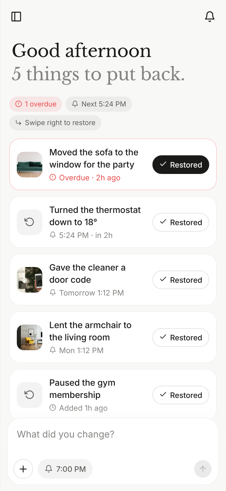
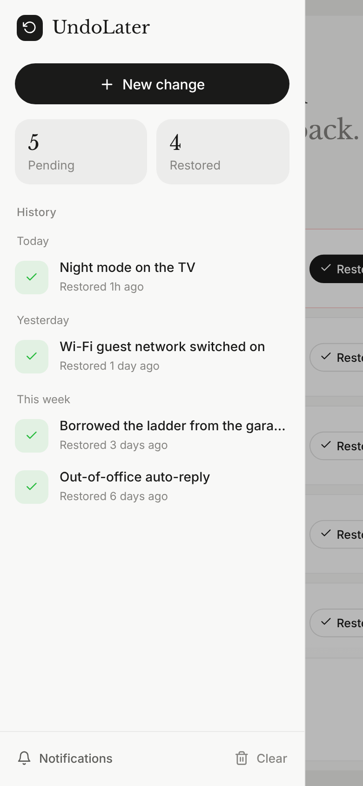
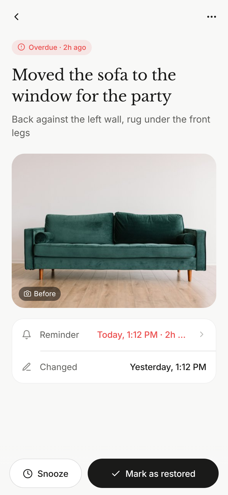
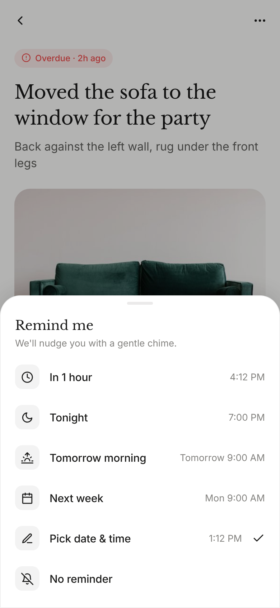
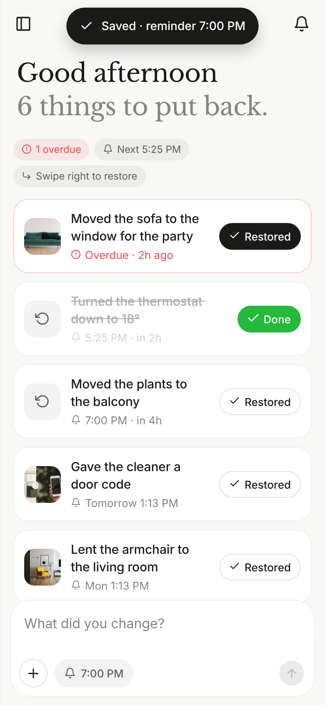
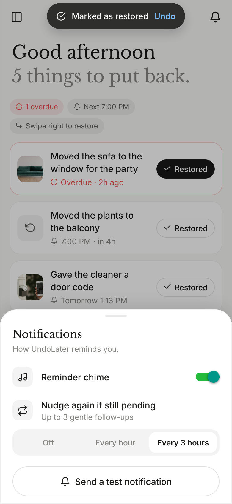
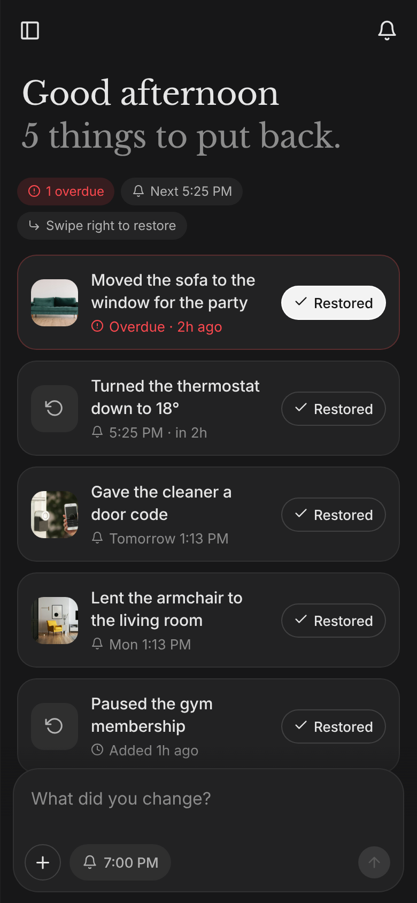
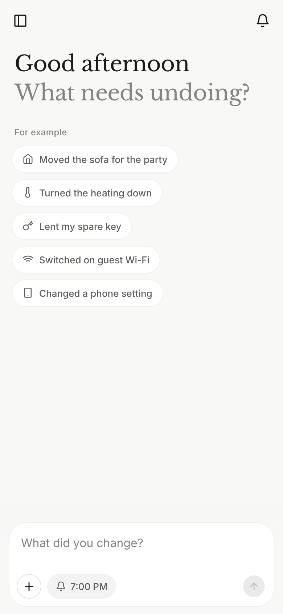

# UndoLater

A small, calm mobile app for remembering to put things back. Moved the sofa for a party, turned
the heating down, lent someone a key? Type it, add a "before" photo if you like, pick when to be
reminded, and tap **Restored** when it's done.

The look follows Manus's mobile app: a warm off-white canvas, near-black ink, serif headlines,
a composer pinned to the bottom, a slide-in sidebar, and soft spring animations throughout.

| Home | Sidebar (history) | Item | Reminder sheet |
|---|---|---|---|
|  |  |  |  |

| Restoring | Notifications | Dark | First run |
|---|---|---|---|
|  |  |  |  |

## Using it

- **Add**: type in the box at the bottom and tap ↑. The **+** adds a photo (camera or library),
  the bell chip picks the reminder (In 1 hour, Tonight, Tomorrow morning, This weekend,
  Next week, any date and time, or none). Empty state suggestions fill the box for you.
- **Restore**: tap **Restored** on a card, or swipe the card to the right. A toast offers **Undo**.
- **Item page**: tap a card. Edit the title and note in place, add or replace the photo, change
  the reminder, snooze, or delete from the **⋯** menu.
- **History**: the sidebar (top-left icon, or swipe in from the left edge) lists everything you've
  restored, grouped by day. Tap one to see it or move it back to pending.

## Notifications

- A custom, gentle three-note chime (`assets/sounds/undo_chime.wav`, synthesised for the app),
  or vibration only if you turn the chime off.
- Exact-time delivery on Android (`USE_EXACT_ALARM`), even in Doze, and reminders survive reboots.
- **✓ Restored** and **Snooze 1 hour** buttons right on the notification; tapping it opens the item.
- Optional gentle follow-ups while something stays pending: off, every hour, or every 3 hours
  (up to 3 nudges). Restoring or deleting cancels them and clears any notification on screen.
- Every launch rebuilds the schedule from your list, so notifications always match what's pending.
- The bell icon (top-right) has the settings and a **Send a test notification** button.

Some phones (Xiaomi, Huawei, Oppo, …) kill background apps aggressively; if reminders arrive
late there, set UndoLater's battery usage to "Unrestricted".

## Build the APK

Needs Node 20+, JDK 17+, and the Android SDK with NDK 27.1.12297006.

```bash
cd undolater
npm install
npx expo prebuild -p android --clean
cd android && ./gradlew assembleRelease
# → android/app/build/outputs/apk/release/app-release.apk
```

Or in the cloud with EAS: `npx eas-cli@latest build -p android --profile preview`.

`npx expo start --web` gives a browser preview of the UI (no notifications or camera there).

## Checks

```bash
npx tsc --noEmit
npx expo lint
npx expo-doctor
```

## Layout

```
src/app/_layout.tsx         fonts, providers, stack navigator, notification tap routing
src/app/index.tsx           home: greeting, pending list, composer, sidebar
src/app/item/[id].tsx       item page
src/ui/                     composer, rows (swipe to restore), sheets, sidebar, toast, primitives
src/notifications.ts        channels, chime, scheduling + follow-ups, action buttons
src/store.tsx               items, persistence, keeps notifications in sync
src/settings.tsx            notification preferences
src/theme.ts                palette and type (from Manus's design tokens)
```
