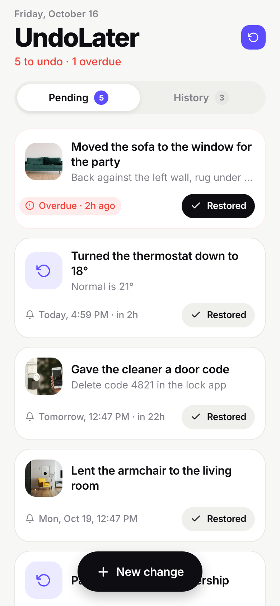
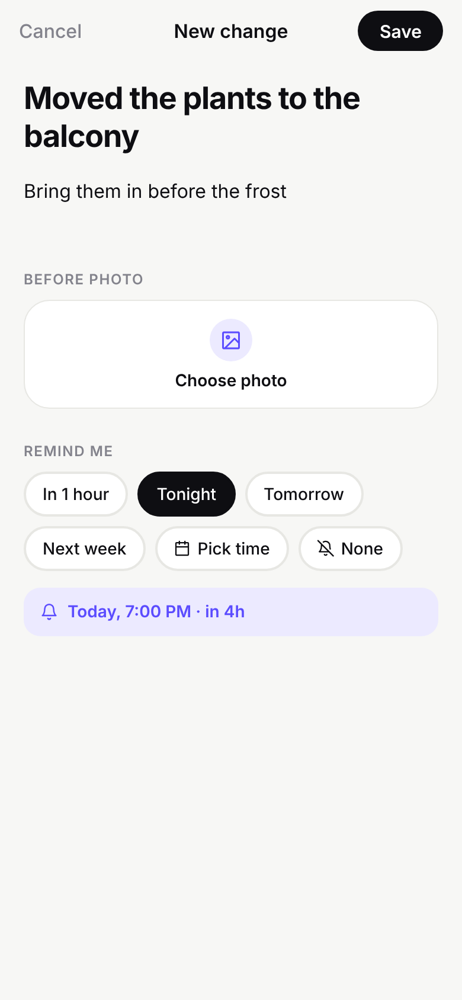
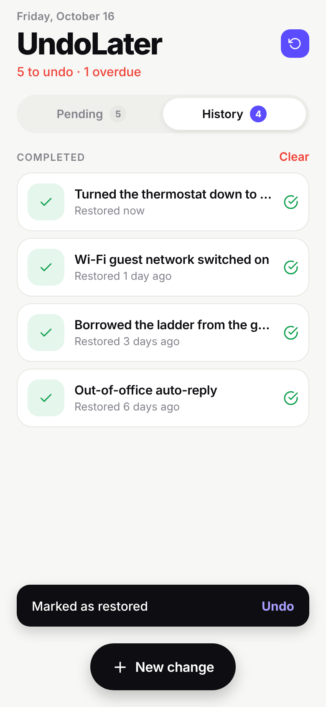
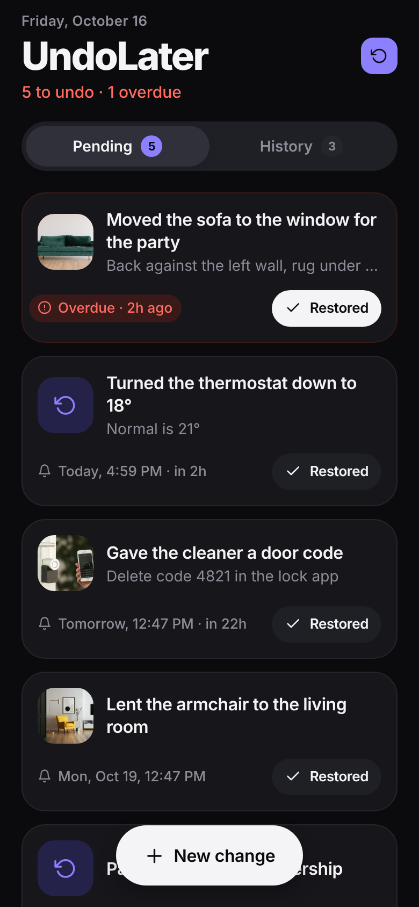

# UndoLater

A tiny mobile app for remembering to put things back. Moved the sofa for a party, turned the
thermostat down, gave someone a temporary door code? Jot it down (with a "before" photo if you like),
pick when to be reminded, and tap **Restored** when it's done.

| Pending | Details | New change | History | Dark |
|---|---|---|---|---|
|  |  |  |  |  |

## What it does

- **Quick entry**: one text field for what you changed, an optional "how to put it back" note,
  and an optional photo from the camera or library.
- **Reminders**: one-tap presets (In 1 hour, Tonight, Tomorrow, Weekend, Next week), a custom
  date and time, or none. A local notification fires at that time.
- **Act from the notification**: it has **Restored** and **Snooze 1 hour** buttons; tapping the
  notification itself opens the item.
- **Pending list**: sorted by due time, overdue items on top in red, each with a **Restored** button.
  Restoring shows an Undo toast in case you tapped by mistake.
- **History**: everything you've restored, newest first. Move an item back to pending or clear it all.
- Light and dark mode follow the system. Everything is stored on the device; there's no account
  and no server.

## Run it

Needs Node 20+ and the [Expo Go](https://expo.dev/go) app, or a development build.

```bash
cd undolater
npm install
npx expo start        # scan the QR code with Expo Go (Android) or the Camera app (iOS)
```

Local notifications, camera and photo library all work in Expo Go. For a standalone app, build
with EAS: `npx eas-cli@latest build -p android` (or `-p ios`).

`npx expo start --web` runs a browser preview of the UI. Notifications and the camera are
mobile-only, so the preview skips them.

## Checks

```bash
npx tsc --noEmit
npx expo lint
npx expo-doctor
```

## Layout

```
App.tsx                     home screen: header, Pending/History tabs, list, sheets, toast
src/store.tsx               items + persistence (AsyncStorage) + reminder scheduling
src/notifications.ts        channel, action buttons, scheduling, tap handling
src/photos.ts               camera/library picker, copies photos into app storage
src/time.ts                 reminder presets and date formatting
src/theme.ts                light/dark palettes
src/components/             cards, tabs, sheets, reminder picker, toast, empty state
```
