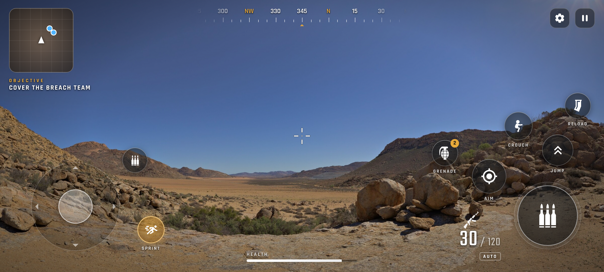

# Desert Breach

First-person **mobile** (Android) war game in **Unreal Engine 5**, built in small parts.

**Part 1 — the breach:** you wake up in the desert among explosions; your two teammates each plant
a charge on a tunnel mouth in a mountain, the entrance blows open and the team goes in.



## How it is built without a local GPU

Everything is code and is built and rendered on a free Kaggle GPU (T4):

| Piece | Where |
|---|---|
| Gameplay, first-person soldier, touch controls (Slate, no binary widgets) | `Source/WarGame` |
| The map, built from code in the editor (headless) | `Tools/Editor/build_breach.py` |
| Engine download (once), build, map, frame capture → mp4 | `Tools/Kaggle` |
| Raw icons (PNG + SVG source) and fonts, imported by the build script | `Content/Raw/UI` |

Mobile first: forward shading, no Lumen/Nanite, MSAA, `Android_Low` / `Android_High` device
profiles — the full look on good phones, still running on weak ones.

```bash
Tools/Kaggle/run.sh engine out/engine     # once; needs Tools/Kaggle/engine_url.txt
Tools/Kaggle/run.sh render out/render 150 1920x1080
```

`engine_url.txt` holds a download link for the Linux build of Unreal Engine (from
unrealengine.com/linux, signed in with an Epic Games account). It is not committed, and the
engine output stays in a private Kaggle kernel: the Unreal EULA does not allow redistributing it.

## Status

- [x] Engine choice, mobile settings, project skeleton
- [x] Touch HUD: layout, icons from icon libraries (see `CREDITS.md`)
- [ ] Step 0: engine on Kaggle — blocked on the engine link and on GPU access for the Kaggle account
- [ ] Desert + mountain + tunnel mouth, wake-up scene, teammates, charges, explosion, entering
